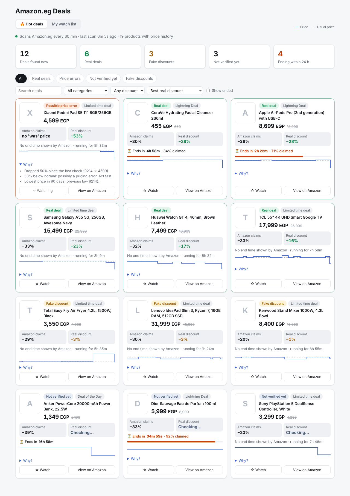

# Amazon.eg Deals

A dashboard that runs on your own computer. It finds discounts on Amazon.eg, checks
whether each one is **real or fake** by comparing it with the product's own price history,
and shows when the deal ends when Amazon gives an end time.

## What it does
- **Finds deals by itself.** About once an hour it reads Amazon.eg's deals page and the
  search results for a few categories (phones, laptops, headphones, air fryers). You can change the list in `config.json` under `scan.queries`.
- **Builds price history for every product it sees**, not only the discounted ones. That's
  what makes the real/fake check possible.
- **Labels each deal**:
  - **Real deal**: at least 15% below what the product normally sold for *before* the deal.
  - **Possible price error**: 50%+ below normal. Act fast.
  - **Fake discount**: Amazon shows a big "was" price, but the product normally sells at about
    this price, or the price was pushed up shortly before the "sale".
  - **Small real discount**: 5-15% below normal.
  - **Not verified yet**: there isn't 3 days of history before the deal started. On the
    first days most deals show this, and it gets better every day the tracker runs.
- **Deal end time**: when Amazon shows a countdown (Lightning Deals, "Ends in 2h 15m") the
  page counts down live and shows how much stock is claimed. Most normal discounts have no
  published end date; for those it shows how long the deal has been running, and when it
  ended once it's gone.
- **My watch list** tab: products you follow closely (checked every 10 minutes), with a full
  90-day chart. Add one from any deal with **☆ Watch**, or paste a link.
- **Telegram** (optional): any scanned deal over 30% off (Amazon's claim, `scan.alert_claimed_min`) with product picture, link, before/now price and our real/fake check; watch-list deals; and scanned deals that are
  verified real and 25%+ off (change `scan.alert_min_discount`).

## Setup on a Mac (once)
1. Download the code (green **Code** button on GitHub, then **Download ZIP**) and unzip it.
2. Right-click the folder and choose **New Terminal at Folder**.
3. Type `python3 --version`. If macOS offers to install developer tools, click **Install**.
4. `cp config.example.json config.json`
5. Optional, for Telegram: create a bot with @BotFather (`/newbot`), press **Start** in your
   bot, then run `python3 -m tracker.cli telegram` and paste the token.

## Run it
    caffeinate -i python3 -m tracker.dashboard

Your browser opens http://localhost:8000. Keep the Terminal window open (`caffeinate` keeps
the Mac awake). Stop with **Control + C**. The first scan starts right away and takes a few
minutes; the page refreshes by itself.

(On Windows: `python -m tracker.dashboard`.)

## If something doesn't work
- **A scan finds no products** on a page: the tracker saves that page into the `debug`
  folder. Send the file to Claude so the reader can be updated for Amazon's current layout.
- **"Paused ... Amazon asked us to slow down"**: Amazon showed a robot check. Everything
  waits (30 min, then 60, then 2 hours) and continues by itself.
- **Amazon keeps refusing (HTTP 503)**: open the deals page or a search in your own browser,
  save it (File > Save As, "Page Source"), and load it with
  `python3 -m tracker.scanner --file ~/Downloads/page.html`. Then run the dashboard with
  `--no-track` so it shows those deals without contacting Amazon.

## About reading Amazon pages
This reads Amazon.eg pages directly, which Amazon's terms of use don't allow; it's meant for
personal use. To stay gentle it makes one request at a time with pauses of 15-30 seconds,
scans at most every 20 minutes, and never tries to get around a robot check. More search
terms or pages per term means more requests and a higher chance of being paused.

## Switching to Amazon's official API (recommended once you can)
Reading pages can get refused by Amazon. The official **Creators API** (it replaced the old
Product Advertising API) supports Amazon.eg, is allowed, and asks Amazon directly for
products that are at least 10% off, with Lightning Deal end times.

1. Join **Amazon Associates** (free) for Amazon.eg and get your account approved.
2. Make some **qualifying sales** through your Associates links. Amazon only opens the API to
   associates who have referred sales.
3. In Associates Central: **Tools → Creators API → Create Application**, then add credentials.
   Copy the **Credential ID**, **Secret** and **Version**, plus your **Partner tag** (store ID).
4. In `config.json` set `"source": "creators_api"` and fill in the `creators_api` section.
   Keep these private; `config.json` is never uploaded to GitHub.

Everything else (dashboard, real/fake labels, Telegram) works the same.

## Command line extras
    python3 -m tracker.scanner --once    # one deal scan, print a summary
    python3 -m tracker.scanner --file deals.html search.html   # read pages you saved
    python3 -m tracker.main --once       # one watch-list check
    python3 -m tracker.cli add "https://www.amazon.eg/dp/B0XXXXXXXX" --title "Kettle"
    python3 -m tracker.cli status        # watch list: now vs usual price

## Files
- `tracker/scanner.py`: finds deals on listing pages, reads end times, judges real vs fake
- `tracker/amazon_page.py`: reads product pages; shared polite fetcher with pause on robot checks
- `tracker/analyzer.py`: usual price and real/fake logic
- `tracker/db.py`: price history and deals (SQLite file `prices.db`)
- `tracker/dashboard.py` + `dashboard.html`: the dashboard (only reachable from your computer)
- `tracker/main.py`, `notify.py`, `cli.py`: watch-list checks, Telegram, commands

## Tests
    python3 -m unittest
